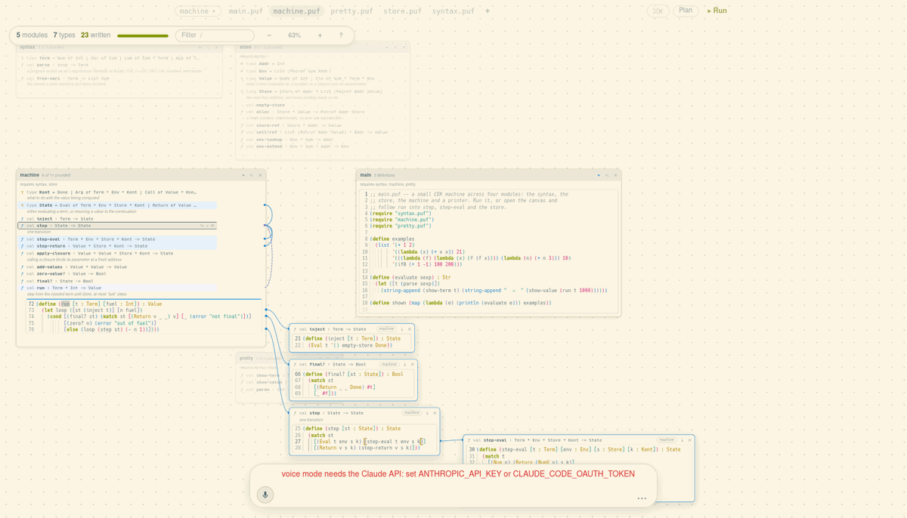
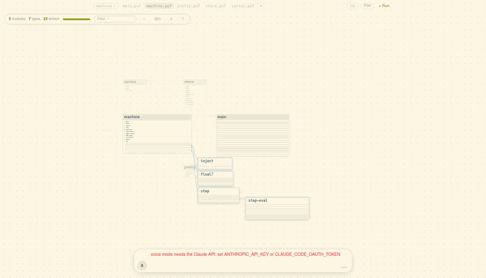
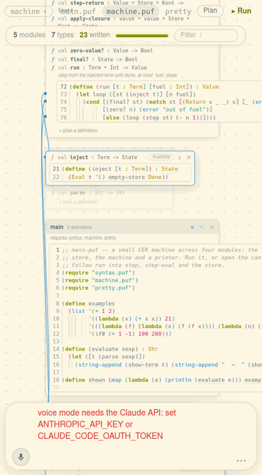
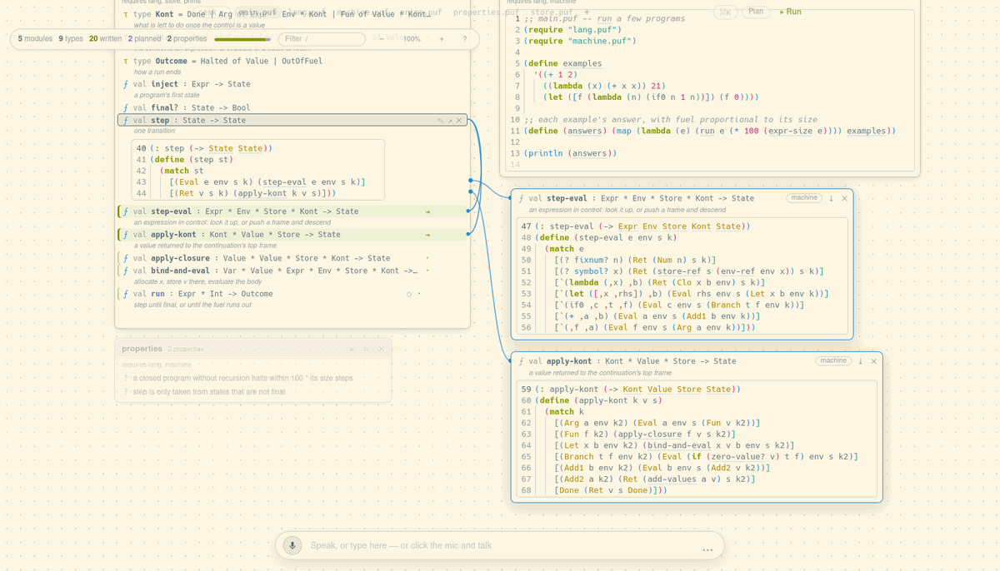

# The canvas: the board and the code as one zoomable surface

Status, 2026-11-25: a prototype on the `view-canvas` branch (strategy A
of three explored in parallel; see the end for what to keep). Page side
only: `studio/web/board.js` (the board, grown into the canvas),
`camera.js`, `span-editor.js`, `board.css`; small hooks in `editor.js`
(`model`), `main.js` and `focus.js`. The server is unchanged: the canvas
keeps its state in the board's JSON (`.puffin/board.json`).

The author's complaint about the module board was that it was a toggle:
the board and the code are two views of one program, kept current with
each other, and switching between them is a weird mechanism. This
prototype removes the switch. There is one surface, and how close you
are to it decides what you see.

## 1. The interaction model

- **One surface, a camera.** The canvas is moved and scaled by a camera
  (`camera.js`): two-finger scroll pans, ⌘/ctrl + wheel (a pinch) zooms
  about the pointer, dragging empty canvas pans, and every programmatic
  move is a glide (a CSS transition on one transform). Nothing scrolls.
- **Far out is the board.** Module cards with ML signatures, one row
  per definition, exactly as docs/PLANNING.md describes (notes,
  decisions, plan mode, the lens, the filter, questions and slices all
  still work).
- **A row opens into its code, in place.** Clicking a row opens a live
  Monaco editor over that definition's lines (with its `(: f τ)`
  declaration) inside the card: a *span editor*. It is on the file's own
  Monaco model, so it is the file: typing writes through files.js like
  any edit, the check's squiggles, holes and session marks appear in it,
  and every other view of the same file (another span, the whole-file
  card, the hidden classic editor) shows the keystrokes as they happen.
  Line numbers are the file's.
- **A cross-reference pulls its definition out beside the use.**
  ⌘-click (or alt-click) a name that is a top-level definition anywhere
  in the program (they are underlined, dotted). Its definition comes out
  as a *pulled fragment*: a small card right of the code that used it,
  its top level with the line of the use, a wire from that line to it,
  and the camera glides to frame the two (and as much of the trail that
  led there as fits at a readable zoom). Fragments from different files
  sit side by side; a fragment's own code can pull further. Hovering a
  name lights its row on the board, wherever it is.
- **Folding back.** ✕ on a fragment folds it (and what was pulled from
  it) back into its row; the camera returns to where it was pulled
  from. ⤓ docks it: it becomes an open row in its own card.
- **A file is a fully expanded card.** ≡ on a card's head (or
  double-click its title, or `w`) shows the whole file as one editor in
  the card. This is the plain editor: there is no separate one. The file
  chips in the bar, ⌘K's files and "back to the code" all open the
  file's card whole and frame it.
- **Keys** (on the canvas, not in code): ↑↓ rows, ←→ cards, ↵ open /
  fold a row, `e` into its code, `]` pull the next thing the cursor's
  definition uses (functions before types; the cursor stays, so `]]]`
  brings out what it calls, in the order of the calls), `[` the next
  thing that uses it, `Tab` from one piece of code to the next, `x` fold
  back, `w` the whole file, `a` take the attention model's suggestions
  (§3), `1` frame the cursor's code, `0` fit everything, `+ −` zoom.
  In code, Esc returns to the canvas with the cursor on that
  definition; ⌘↵ evaluates the form, ⌘S saves.
- **Semantic zoom.** At 62% and closer: everything. Between 38% and
  62%: comments go, code stays but is not for editing (dimmed, no
  pointer), card names grow to stay readable. Further out: rows are
  bare names, code is drawn as its shape (lines), fragments are their
  names, large. A change of level re-places what hangs off the cards
  (their heights change).

  

- **Narrow windows.** Under 700px the cards stack in one column (the
  board's compact mode) and pulled code goes *below* the code that uses
  it, never beside it.

  

## 2. What is shown when: the defaults

1. **The whole program's signatures, always.** Every module has a card;
   code is added to the cards, it never replaces them. This is the
   prototype's answer to "the board and the code are one".
2. **A fresh canvas** shows every card, and the file that was being
   edited whole if it is 40 lines or shorter (code from the first
   moment, without hiding the design); the camera fits it all.
3. **Coming back** (a reload, a resize, switching the voice/full
   layouts): the camera frames the last pulled code and the trail it was
   pulled from; else it fits the program.
4. **A working set of at most four pulled definitions.** A fifth folds
   back the one touched (focused, pulled, jumped to) longest ago — never
   the one just pulled or the trail it hangs from. Explicitly opened
   rows and whole files do not count: what the author opened stays.
5. **What recedes.** With code pulled out, cards that show no code
   recede (faded, still clickable). With a definition in focus and the
   attention model on (§3), cards holding nothing it suggests recede.
6. **Placement.** Pulled code goes right of the code using it, level
   with the use, ordered down the use lines so wires do not cross; it
   never covers a card that shows code or other pulled code (it moves
   below or past it, whichever is nearer).
7. **The builder.** Its edits open where they land (the board's
   `auto_arrange`, unchanged), so they appear as live code in their
   cards.

## 3. The attention model (strategy C) on the canvas

Merged from `view-relevance` (docs/ATTENTION.md). The canvas does not
let the model move code around on its own; it *marks*. With a
definition in focus (the row under the cursor, or the code being typed
in) the canvas ranks the program and:

- a definition the model would show **in full** gets a strong green
  mark and ⇥, which pulls it beside the focus;
- one it would show **folded** or as a **signature** gets a faint mark;
- every mark's tooltip says why ("step uses it, through apply-kont;
  beside step in machine.puf");
- `a` takes the suggestions: each full one is pulled beside the focus.

What the author does is reported: a ⌘-clicked name the model did not
suggest is a **pull** (its miss, its best lesson), a suggestion taken
an **open**, code taking the keyboard a **focus**, typing in a
definition an **edit** (and `tracker.edit`), more than two seconds in
it a **dwell**, hiding a row **show less**. The model learns from the
project's log when the page opens.

## 4. What worked

- **Shared models are the right foundation.** A span editor is a
  second Monaco editor on the file's model with `setHiddenAreas`; edits
  everywhere are free and immediate, and every model-level decoration
  (check errors, holes, session marks) shows in every span with no extra
  code. Monaco hit-tests correctly under the camera's CSS scale (checked
  at 0.55 and 0.7), so code stays editable while zoomed.
- **Pull-beside-the-use with a wire** reads well: "where does this go"
  is answered spatially, and the wire from the exact line keeps the
  reason visible. `]]]` (breadth: everything a function calls, in call
  order) was more useful than walking depth-first, which I tried first.
- **The camera glide** makes pulls legible: you see where the code came
  from on the board as it travels.
- **Whole files as cards** retire the mode switch without losing the
  plain editor; the hidden classic editor still backs the assists, the
  REPL's "eval form", rename, etc., by following the code in focus
  (`files.open`).

## 5. What felt wrong, or is unfinished

- **Pulled chains drift.** Each pull goes right of its source, so a
  long trail becomes a diagonal staircase that wanders over other
  cards' territory and leaves the rest of the screen empty. A better
  layout would reflow the working set as a column (or a tree) beside the
  focus, which is close to strategy B's working-set pane — a sign the
  two should merge: the canvas for the overview and the trail's wires,
  a laid-out working set for reading.
- **Framing at readable zoom vs. context.** Code is comfortable at
  ≥ 80%, so a trail of more than two or three wide definitions never
  fits; the camera then shows the newest end. The far levels of the
  semantic zoom are good for orientation but there is no level that
  shows *code* and *the whole program* at once.
- **Everything is rebuilt on every render.** The board re-renders whole
  cards on each outline update; span editors are moved, not rebuilt,
  and the one being typed in is re-focused. It works, but a keyed DOM
  update would be cleaner and cheaper.
- **The attention marks are hints only.** It is not yet decided how
  much the model should do unasked (auto-pull the top suggestion?
  pre-open it as a faint "ghost" fragment?). Dwell is focus time only,
  not visible-and-read time.
- **Not done:** dragging pulled fragments (they are placed, not
  movable); the hidden classic editor still exists underneath (the
  tabs bar is covered, not removed); the voice router's
  "show the board" / "back to the code" now mean *fit everything* /
  *the shown file whole*, but its prompt still describes a toggle;
  pulled fragments of a renamed definition simply disappear; no tests
  for the page code (the server is untouched, `cargo test` passes).

## 6. Reusable pieces

| piece | file | what it is |
|---|---|---|
| span editor | `studio/web/span-editor.js` | a Monaco editor over one top-level definition (or a whole file) on the file's shared model; tracks the span by name across edits; sizes itself to its lines; marks cross-references and reports ⌘-click / hover / focus / edit / Esc / ⌘↵. Needs `editor.model(key, text)` (editor.js). |
| camera | `studio/web/camera.js` | pan/zoom by one transform with animated glides: `frame(boxes, {min, max, top})`, `fitting(boxes)`, `reveal(box)`, `zoomBy`, `toCanvas`, wheel/pinch/drag handling. No dependencies. |
| shared models | `editor.js` `model(key, text)` | the hidden editor's documents as the single model per file, for any number of other views |
| wire renderer | `board.js` `renderPulls` / `useAnchor` | a bezier from a code line (`span.lineTop(span.lineOf(name))`) to a fragment's head, from layout coordinates (`canvasBox`), not the screen, so it is right mid-glide |
| placement | `board.js` `placePulled` | right of the source, level with the use, sorted by use line, nearest move off obstacles; below in narrow windows |
| working set | `board.js` `pull` / `evict` / `fold` / `dock` | at most four pulled, least-recently-touched folds back, never the trail of the newest |
| attention hook | `board.js` `attend` / `applyAttention` / `takeSuggestion` | rank around the focus, mark rows with reasons, take the suggestions, report the signals |

The demo is `studio/demo/machine` (from `view-relevance`: a CESK machine
in five modules with properties). The earlier screenshots (overview,
far, narrow) were taken on this branch's first demo, a CEK machine with
the same shape, replaced in the merge.
