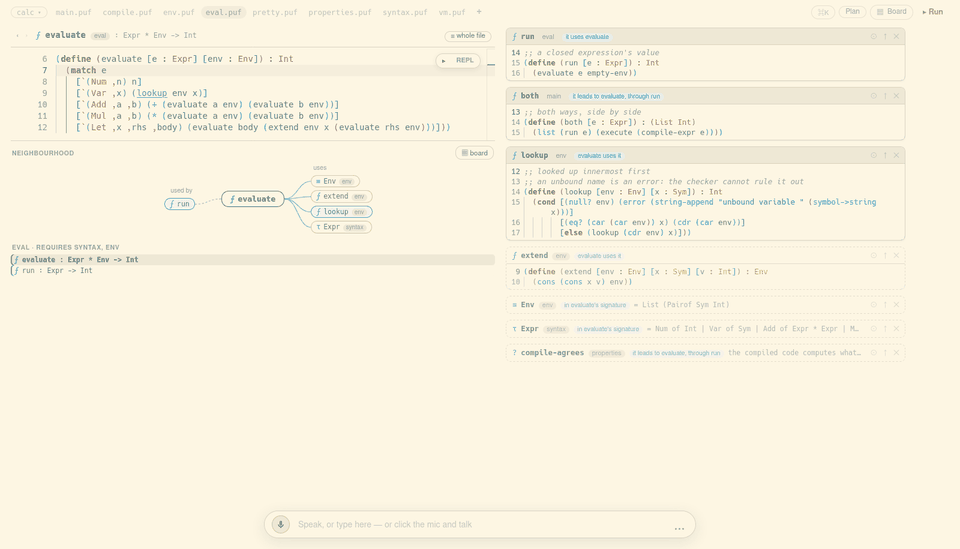
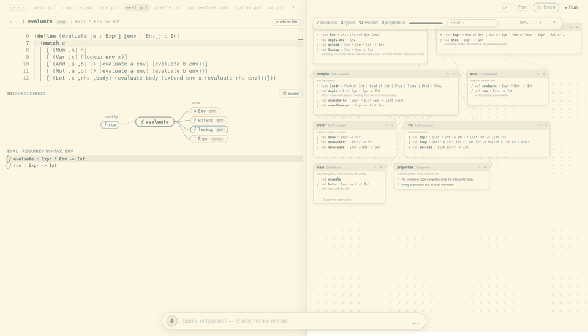
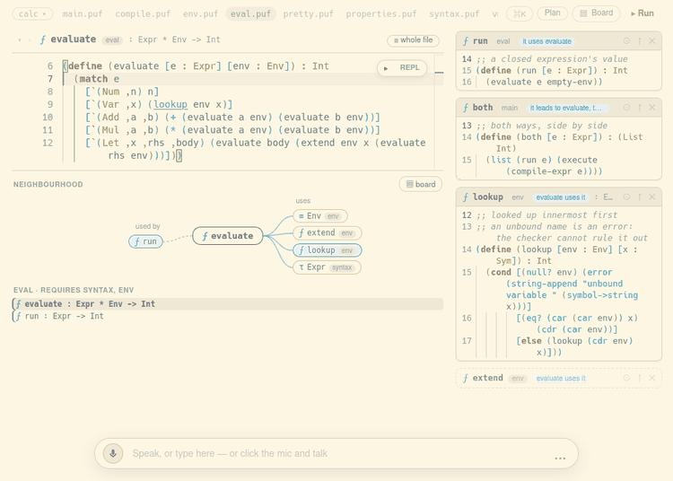
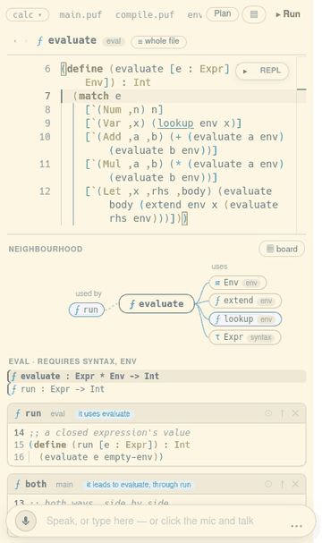
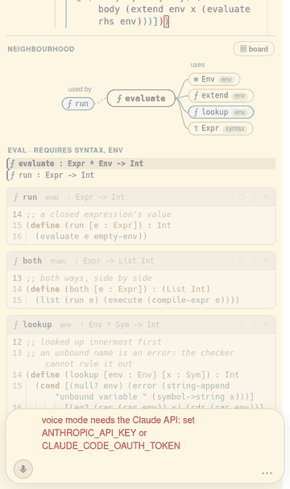

# Focus and context: the code and the board on one screen

Status, 2026-11-25: a working prototype on the `view-focus` branch
(strategy B of three explored that night). Page `studio/web/workset.js` +
`workset.css`; small additions to `editor.js` (more views of one
document), `files.js` (edits from those views), `board.js` (its ↗ can
focus instead of leaving), `focus.js`, `main.js`. What fills the room is
the attention model (`attention.js`, docs/ATTENTION.md, merged from
`view-relevance`). Demo project: `studio/demo/calc/` (seven modules: an
interpreter and a compiler to a stack machine that must agree).

The author's complaint was that the board is a *toggle*: the board and
the code are two views of one program and should be on the screen
together, with the code for several definitions that are not
syntactically next to each other visible at once, pulled in by
following cross-references. This view answers it with one screen and no
modes:

## 1. The screen

- **The focus** (left, top): the editor itself, narrowed to one
  definition — its comment and `(: name τ)` included — with Monaco's
  hidden areas. Editing it is editing the file (same model, same undo,
  same markers, holes, paredit, Emacs keys). The header names it and its
  ML signature, with ‹ › for the history. The pane is as tall as the
  definition and as wide as its lines need (60–100 columns).
  **≡ whole file** (⌥O) shows the rest of the file; the focus then just
  follows the cursor, and ⌥O narrows to wherever it is.
- **The neighbourhood** (under the focus): the board's slice of the focus
  from the outline (board.rs): what uses it on the left, what it uses on
  the right, wired (violet dashed in, blue out); its module's rows beside
  (or under, by a container query); the properties that mention it. Click
  a node: its code comes beside the focus. ⌘-click or double-click: focus
  it. Nodes already in the working set are tinted.
- **The working set** (right): other definitions, from any file, each a
  small live Monaco editor on the *same model* as its file, narrowed to
  the definition by hidden areas and kept on it as the text moves (a
  tracked range covers unbalanced moments). An edit in a fragment is an
  edit to the file: it goes to the studio through `files.edited` like
  typing, and every other view of that file — the focus, other
  fragments, the board's outline — follows.
- **The board, grown** (▦ board, ⌘⇧B): the whole module board slides
  over the working set, beside the focus, fitted to the room. A row's ↗
  there focuses that definition in the pane on the left — the board
  stays. So the board is never instead of the code.

## 2. Moving around

| gesture | does |
|---|---|
| ⌘-click a name (any code view), ⌥. on it, click a node or module row | pull its definition into the working set (to the top, gliding the others down) |
| ⌘⇧-click a name, ⌥. on one already pulled in, double-click a node, a fragment's name or ↑ | focus it |
| ⌥← ⌥→ (or ⌥, — Emacs's M-, after M-.), ‹ › | back and forward through the focus history |
| ⌥O, ≡ whole file / ◎ just *f* | widen the focus to the file / narrow it again |
| F6 / ⇧F6 | the focus, then each fragment in turn; Esc in a fragment returns |
| ⊙ / ✕ on a fragment | pin it / put it away (on an offered one: "show this less") |
| ▦ board, ⌘⇧B | the board beside the focus, and back |

Focusing never loses where you were: the definition you leave goes to
the top of the working set (badge: why it matters to the new focus).
Anything else that moves the cursor outside the focused definition — the
palette, F8 to a hole, voice navigation, the board — moves the focus
there, so every existing way of navigating keeps working.

## 3. What is shown when (the default prioritization)

Three tiers, in order of authority:

1. **What the author did.** The focus, and what they pulled in, stay
   until they put it away. Pins stay whatever else needs the room.
2. **What the model offers.** In the room the set leaves, the attention
   model's ranking of the moment (focus, the builder's unseen edits,
   failing properties, errors, voice mentions, what the author keeps
   reading, …) is offered: dashed, in its order, at its detail — *full*
   is a live fragment, *folded* or *signature* is just its head line with
   the signature — each with its first reason as a badge and all of them
   on hover ("evaluate uses it; part of env.puf's interface"). Using one
   (clicking into it, pinning it, ⌘-clicking its name) takes it into the
   set.
3. **Short of room.** Every fragment in the set first keeps at least its
   signature line; bodies go to the most wanted — the model's score plus
   a bonus for what was touched lately (3, halving every five minutes) —
   and the rest collapse to their head line. Only a fragment *arriving*
   ever sends the least wanted to the **shelf** (chips under the set, a
   click from coming back); a resize or a reload never takes anything
   away (the column scrolls instead). A fragment the model would no
   longer show (score under a signature's worth) fades.

The first screen of a project: the shown file whole if it is short
(≤ 60 lines; a script like main.puf reads best whole), else its first
definition focused. What was out, focused and pinned is remembered per
project in this browser.

Every interaction is reported to the model (docs/ATTENTION.md §3):
`pull` when the author brings in something it did not offer (its miss,
the most valuable lesson), `open` when they take an offered one, `edit`
(throttled, and the changed lines to the tracker), `focus`, `dwell`
(hover past 2 s), `showLess` on ✕ of an offered fragment, pin/unpin. The
weights it learns from that are this author's.

## 4. Widths

- **≥ 1350px**: focus + neighbourhood | working set (the screenshots
  above).
- **700–1350px**: the same two columns, the module card under the map.
- **Phones**: one scrolling column — the focus (most of a screen), its
  neighbourhood, then the set; nothing is evicted (there is no fixed
  room), the pill stays fixed.

  

## 5. What worked

- **One model, many views** is the real win: hidden areas on shared
  Monaco models mean a fragment *is* the file, so write-through, undo,
  diagnostics, the builder's edits arriving and the outline updating
  are all free and instant. No splicing, no second source of truth.
- **The focus following the cursor** makes every older way of
  navigating (palette, holes, voice, board ↗) drive the new view without
  changes to them.
- **The neighbourhood under the focus** reads as one unit and uses the
  room a short definition leaves; a separate third column wasted it.
- **"Where I came from" goes into the set on a jump**: following a chain
  of calls (both → run → evaluate → lookup) leaves a readable trail.
- **Offered, dashed, with a reason**: the model's suggestions are
  visibly different from the author's choices and cost one click to
  accept or dismiss — and each of those clicks is a training signal.

## 6. What felt wrong, or is unfinished

- **Short definitions still leave blank space** in the focus column when
  the neighbourhood is small; a long one squeezes the neighbourhood.
  The split is a heuristic (the neighbourhood gets up to half).
- **Fragments wrap** long lines in a narrow column; Lisp reads worse
  wrapped. A wider set (or zooming a fragment wide on hover) would help.
- **Order in the set is recency**, not relation to the focus: stable
  places help spatial memory, but after several jumps the most relevant
  fragment can sit low. The model's score only decides who collapses.
- **Two collapse mechanisms** (the model's detail for offered fragments,
  the room-fit for the set) could be one: ask `rank` with the set as
  pins and use its detail for everything. Not done because pins always
  rank above unpinned and the fit needs measured heights.
- **The board grown** keeps its own saved card positions; it is fitted
  by zoom, which at 1000px makes it small. A board laid out for the
  half-width it has would read better.
- **No keyboard path into the neighbourhood** (arrow keys over nodes),
  and the hover-to-underline for ⌘-click only appears while the modifier
  is held over a name.
- On a phone the fragments can come up faded on the first render (the
  model's verdict is asked before its first ranking with that budget).
- Untested against the live builder (no credentials locally): the
  builder's edits reach the tracker through the same messages the board
  uses, but the "builder changed it, not yet seen" lift has not been
  seen on screen.

## 7. Reusable pieces

| piece | where |
|---|---|
| `spanOf(text, name)`: a definition's lines with its comment and declaration | workset.js |
| narrowing any Monaco view to a span, kept on it while editing (hidden areas + tracked range) | workset.js `narrowView`, `currentSpan` |
| more views of one document: `editor.model`, `editor.fragment`, `editor.setText`, `onOtherChange` | editor.js |
| edits from a view of a file that is not shown | files.js `edited`, `showText` |
| the neighbourhood map (callers → focus → callees, wired, horizontal or stacked) | workset.js `renderGraph`, `drawWires` |
| the board's ↗ deferring to another view | board.js `navigate` option |
| ⌘-click / ⌥. cross-references in any Monaco view, with the hover underline | workset.js `bindNames` |
| the attention wiring (tracker on every message, observe calls) | workset.js `offer`, `receive`, `noteEdits` |
