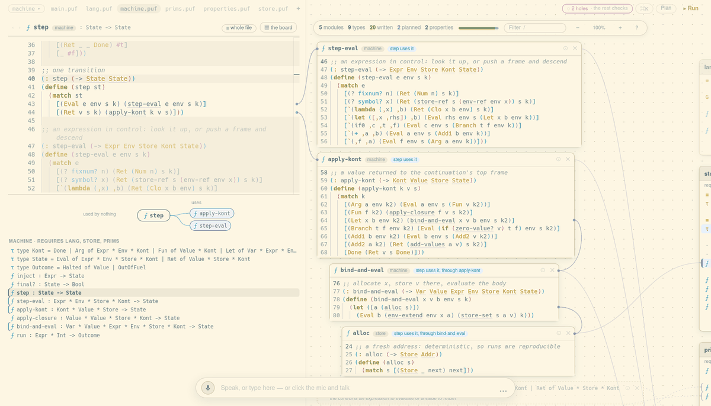
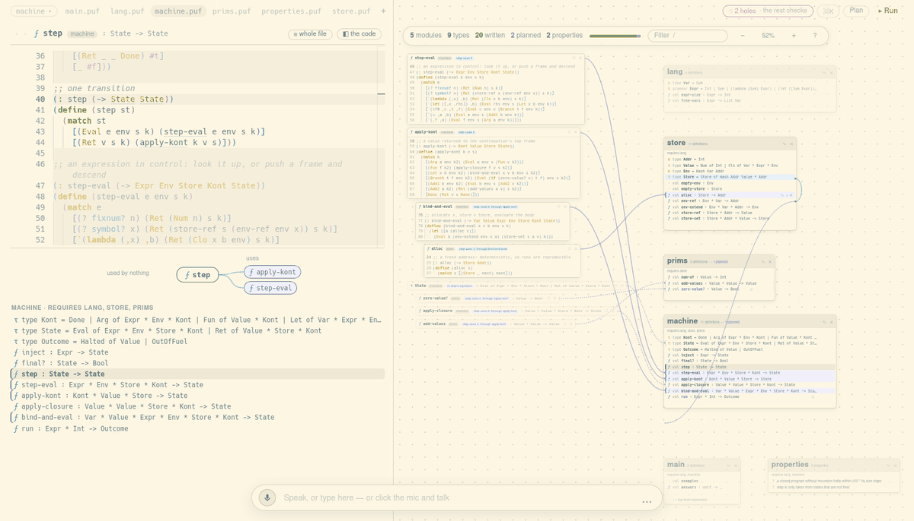
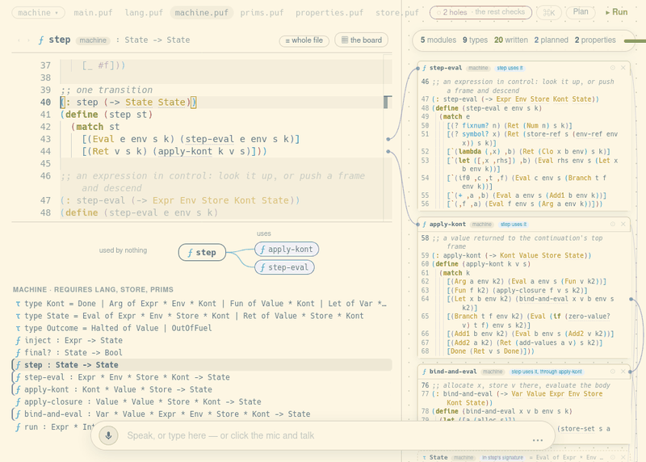
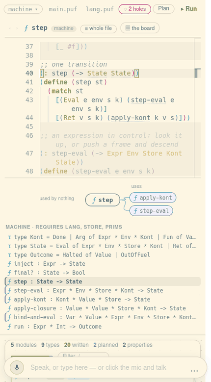

# The view: the code and the board as one screen

Status, 2026-11-25: on the `view` branch, the studio's one code view.
It unifies two prototypes of that night (a zoomable canvas, and a
focused editor with a working set; their branches `view-canvas` and
`view-focus` keep their write-ups) around the attention model
(docs/ATTENTION.md). Page: `studio/web/view.js` + `view.css` (the focus,
the neighbourhood, the working set), `board.js` + `board.css` (the
board and its lane), `camera.js`, `fragment.js`, `span.js`, `names.js`,
`wires.js`; server: the working set and the camera requests in the
board's JSON (`board.rs`), and the voice verbs that use them.

The author's complaint was that the module board was a *toggle*: the
board and the code are two views of one program, kept current with each
other, and should be on the screen together — the code of the function
being worked on, the code of the others it is read with (however far
apart they are in the files), and the design around them, with what is
needed there at the moment it is needed. There is no mode in this view:
one screen, and how close the camera is decides how much of the program
it shows.

## 1. The screen

- **The focus** (left, top) is the editor itself, narrowed to one
  definition — its comment and `(: name τ)` included — by Monaco's
  hidden areas, so editing it *is* editing the file (one model per file:
  same undo, same squiggles, holes, paredit and Emacs keys). Where it is
  shorter than its room, the lines of the file around it fill the room,
  dimmed: there, a click away from being the focus. Its header says what
  it is (`ƒ step · machine : State -> State`), with ‹ › for the focus
  history. **≡ whole file** (⌥O) widens the focus to the whole file;
  the focus then follows the cursor, and ◎ (⌥O) narrows to wherever it
  is. There is no other editor: a file chip, the tree, ⌘K's files open
  the file whole in the focus.
- **The neighbourhood** (under it) is the board around the focus, from
  the outline: what uses it on the left, what it uses on the right,
  wired; the properties that mention it; its module's rows. Every node
  is a key stop: arrows walk them by where they sit, ↵ brings a node's
  code into the lane, ⇧↵ (or a double-click) focuses it, `]` and `[`
  bring what it uses or what uses it, Esc goes back to the code.
- **The board** (right) is one zoomable surface, moved by a camera
  (two-finger scroll pans, ⌘/ctrl-wheel or a pinch zooms — on a touch
  screen too — dragging empty board pans; programmatic moves glide). On it are the module cards of
  docs/PLANNING.md — ML signatures, one row per definition, notes, the
  decisions card, questions and slices, plan mode, hiding, the HUD, the
  filter, the lens — and, left of the cards, **the lane**: the working
  set, each definition as live code (a *fragment*: another view of its
  file's model, narrowed to it, growing as it is typed in).
- **The lane reads as a tree** of where each definition is needed: one
  the focus uses sits at its left edge, wired from the very line that
  uses it; one that only a fragment above it uses sits a step in (two at
  most), wired from that fragment's line round the lane's right side.
- **Wires** say "this uses that" in one visual language: from the line
  in the focus that uses a name to its fragment (crossing from the focus
  into the board), from a line in one fragment to a fragment below it
  that it uses, from each fragment to its row on its card, from callers
  and to callees in the neighbourhood, and from a row to what it uses
  under the lens.

### Zoom is the only mode

Close in (62% and closer) the camera frames the lane as a column of
code beside the focus: reading distance. Zooming out — the wheel, a
pinch, ⌘⇧B, the ▦ button over the focus, "show the board" — glides
continuously out to the whole program: the cards with their signatures,
the lane's fragments drawn smaller, each wired to its row (rows in the
set are marked violet, offered ones faintly, the focus's row strongly;
cards holding none of them recede). Further out (under 38%) rows are
bare names and code is drawn as its shape. ⌘⇧B again, the ◧ button, or
"back to the code" glides back in to the lane. A click on a row brings
its code into the lane and the camera back to it.

The geometry was chosen by trying both: fragments as *expanded rows on
their cards* (with the near view a camera path over them) scatter the
working set across the board — the "staircase" the canvas prototype
ended in, never readable at once. A *lane with wires to the rows*
keeps the working set a tidy column at reading distance and still shows,
one zoom away, where each piece lives.

## 2. Moving around

| gesture | does |
|---|---|
| ⌘/ctrl/alt-click a name (focus or fragment), ⌥. on it, click a row or a node, ↵ on a node | its definition into the lane (camera to it) |
| ⌘⇧-click a name, ⌥. on one already in the lane, double-click a row or node, its fragment's name, ↗ on a row, ⇧↵ on a node | focus it |
| `]` / `[` on a row or a node | the next of what it uses / what uses it, into the lane |
| ⌥← ⌥→ (⌥, as Emacs's M-,), ‹ › | back and forward through the focus history |
| ⌥O, ≡ / ◎ | widen the focus to the whole file / narrow it again |
| ⌘⇧B, ▦ / ◧, the zoom label, `0` / `1` on the board | out to the program / back in to the code |
| F6 / ⇧F6 | the focus, the neighbourhood, then each fragment in turn |
| ⊙ / ✕ on a fragment | pin it / put it away (on an offered one: "show this less") |

Focusing never loses where you were: the definition you leave goes into
the set. Anything that moves the cursor outside the focused definition
— the palette, F8 to a hole, voice navigation, a click in the dimmed
lines — moves the focus there, so every older way of navigating drives
the view unchanged. Hovering a name, a node or a row lights everything
showing that definition: its row, its fragment, its node.

## 3. What is shown when: the defaults

**One call decides.** What the lane holds, in what order and at what
detail, is one `rank` of the attention model (docs/ATTENTION.md) with
the focus and the working set in its state:

- the **set** — what the author brought in — is scored like everything
  else (feature `kept`: half for being there, half more while touched
  lately; `pinned` for a pin), not put first: a definition just pulled
  in shows its code; one untouched for a quarter of an hour folds to its
  row; one an hour old is a signature line. A member is *owed* a place:
  it is never dropped for room.
- what the model **offers** beside them (dashed, the first reason as a
  badge, all of them on hover: "step uses it, through apply-kont")
  fills the room left, up to five, at the detail their score buys —
  *full* is live code, *folded* the row with its comment, *signature*
  one line. Using one (typing in it, pinning it, double-clicking its
  head, pulling its name) takes it into the set.

**Stability.** The lane reorders, and changes a fragment's detail, only
when something *arrives* (a pull, an offer taken, the voice pulling
something in) or when the author has been still for 2.5 s with the
pointer off the lane and no fragment being typed in. Otherwise what is
there holds still and only what is new comes in, where it ranks — the
lane never moves under the author's eyes. What does move glides.

**Room.** The set holds eight; an arrival beyond that sends the
lowest-scored unpinned member (never the one arriving, never the one
just left) to the **shelf**, chips under the lane a click from coming
back. Nothing else ever takes a fragment away.

**First screen.** A project opens on the shown file whole if it is
short (60 lines or fewer: a script like `main.puf` reads best whole),
else its first definition focused; afterwards the focus, its history
and the shelf are remembered per project in this browser, the set with
the board (`.puffin/board.json`, so the voice can change it). The
camera starts at the lane and stays framing it as it changes until the
author moves it themselves.

**The builder.** Its edits are news the model lifts (`builderEdit`:
"the builder changed it 2 min ago, not yet seen") — offered beside the
focus, not forced open on a card. A question it asks still lays out its
slice on the board, and the camera glides out to show it.

## 4. The learning loop

Everything the author does with the lane is told to the model, and
logged (`.puffin/attention-log.jsonl`, never committed):

| the author | signal |
|---|---|
| brings in what the model did not offer (⌘-click, a row, a node) | `pull` — its miss, the most valuable lesson |
| takes an offered fragment | `open` |
| types in a definition (once per visit) | `edit`, and `tracker.edit` |
| moves into a definition | `focus` |
| stays in one for more than 2 s (hover or typing) | `dwell` |
| ✕ on an offered fragment, or hides a row | `showLess` |
| ⊙ | `pin` / `unpin` |

On open the page relearns this project's weights from the whole log
(`learnFrom`): pairwise preferences, kept within a band of the defaults,
and only if they predict the most recent behavior better
(docs/ATTENTION.md §4). The set and pins are the author's own choices,
so they teach nothing: `kept` and `pinned` are never learned, and the
log draws no preferences from them.

## 5. Voice

The router's `arrange` verbs are camera moves and set changes now
(board.rs `Studio::arrange`):

| said | does |
|---|---|
| "show the board", "zoom out" | `show-board`: the camera glides out to the program |
| "back to the code" | `show-editor`: back in to the lane |
| "pull in alloc", "bring out step", "open eval-expr" | `pull`: into the set, the camera to the code |
| "show me step next to inject" | `beside`: both into the set, the one it is next to first |
| "put alloc away" | `close`: out of the set |
| "hide …", "just show …", "what touches …", notes, cards | as before (docs/PLANNING.md), and the camera glides out to show it |

The page moves once per request (`board.look`, counted); a reload does
not replay the last one. The builder has the same verbs in its
`arrange` tool, and is told to pull in what it is explaining.

## 6. Widths

- **Wide** (≥ 1350px): the focus as wide as its lines need (60–100
  columns, at most three fifths of the room) and the board beside it.
- **Middling** (1000px): the same; the board keeps at least two fifths
  and stacks its cards under the lane; the lane's code wraps to what the
  board can show at reading distance (≥ 75%).
- **Phones**: one scrolling column — the focus, its neighbourhood, then
  the board (the lane on top, the cards under it); wires across panes
  are left out, the pill stays fixed.

 

## 7. How it is built

| piece | file | what it is |
|---|---|---|
| the view | `view.js` | the focus (narrowing, the lines around it, history, whole file), the neighbourhood and its keys, the set and the ranking, the lane's fragments, the wires across the panes, the learning signals |
| the board | `board.js` | cards, rows (`renderItem`), notes, decisions, questions and slices, plan mode, the HUD, filter, keys, the lens; the lane's place, its wires to rows, the row marks; `home` / `overview` |
| the camera | `camera.js` | one transform, glides, wheel/pinch/drag; `onFrame` on every frame of a glide (for the wires across the panes) |
| a fragment | `fragment.js` | a Monaco view of one definition on its file's model, sized to it, wrapping past the board's reading width |
| spans | `span.js` | a definition's lines (`spanOf`), the definition at a line, narrowing any view to one and keeping it there as the text moves |
| names | `names.js` | cross-references marked, ⌘-click, ⌘⇧-click, hover — in the focus and every fragment |
| wires | `wires.js` | one curve shape, a wire with its dots, an overlay for wires between panes |
| more views of a file | `editor.js` `model`, `fragment`, `setText`; `files.js` `edited` | every view of a file is a view of its one model; an edit in a view of a file that is not shown goes to the studio like typing |

The server keeps the set (`set: [{ id, at, pinned }]`) and the last
camera request (`look: { to, n }`) in the board's JSON; the page keeps
the camera, the focus and its history. The attention model and its log
are unchanged in kind (docs/ATTENTION.md); the model gained the set as
part of its state.

## 8. Not done

- The lane's order is the model's, not the call graph's: a fragment is
  indented under what needs it, but not moved next to it.
- Fragments cannot be dragged, and the lane cannot be moved on the
  board; the cards still can.
- Dwell is hover or typing time, not visible-and-read time.
- Untested against the live builder here (no credentials): its edits
  reach the model through the same messages as before.
